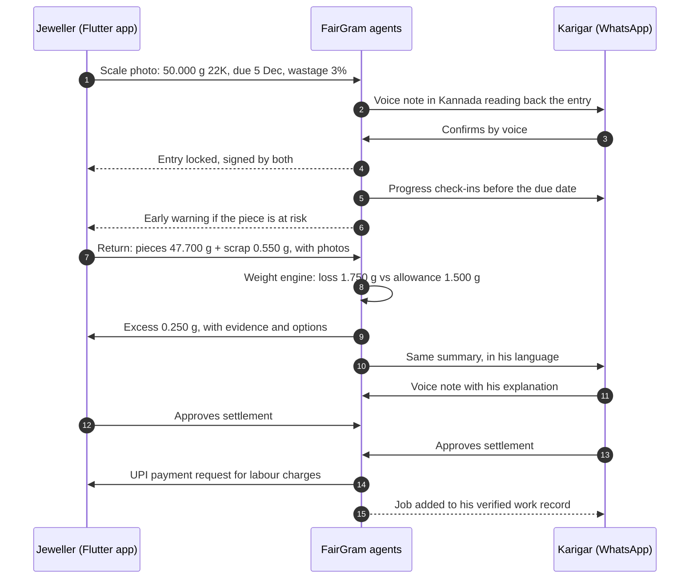
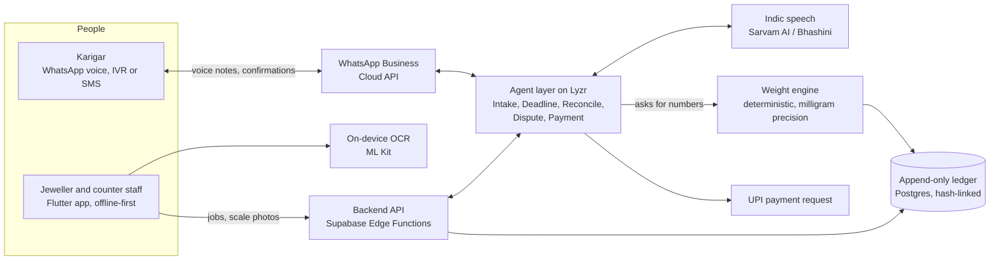

# FairGram

**Fair to the gram, for both sides of the counter.**

FairGram is a voice-first, two-party gold ledger run by AI agents, for jewellers and the karigars (artisan goldsmiths) who make their jewellery on job-work.

> Built for **Tech4Bharat 2026** (GAVS Hackathon) · Theme 2: Jeweltech · Problem 2.2: *Gold given to karigars for job-work is tracked on trust, and disputes follow.*
>
> **Status:** idea round. The prototype is built between 23 Nov and 15 Dec 2026 (see [Build plan](#build-plan)).

---

## The problem

A jeweller hands a karigar gold by weight and expects finished pieces back, less an agreed wastage allowance. Today:

| Step | How it's handled | What goes wrong |
|---|---|---|
| Issue | Weight written on a slip or in a notebook | Each side keeps its own numbers |
| Wastage | Agreed verbally | Nobody can prove what was agreed |
| Deadline | Chased by phone | Pieces miss the customer's wedding date |
| Accounts | Squared at month end | Disputes, and artisans paid weeks late |

Jewellery ERPs (Tally, OMGOLD, Joolet and others) already have karigar job-work modules, but they keep **only the jeweller's record**. The karigar has no copy and no say, and that is where disputes start.

## The idea

**One shared ledger that both parties sign.** Every issue, return and settlement is confirmed by the jeweller *and* the karigar. Nobody edits an entry; corrections are new entries.

- **Voice-first for the karigar:** he confirms jobs, reports progress and raises disputes with WhatsApp voice notes in Kannada, Hindi, Bengali or Tamil. No app install needed.
- **Agents do the chasing:** they read scale photos, watch deadlines, reconcile weights, lay out evidence when numbers differ, and request payment.
- **Fair by design:** settlements need both approvals, the karigar sees his full account across every jeweller he works for, and his verified work record belongs to him.

## How one job flows

## Architecture

### The agents

| Agent | Job | Never does |
|---|---|---|
| **Intake** | Turns a scale photo or voice note into a draft entry for both sides to confirm | Write an entry without both confirmations |
| **Deadline** | Ties each job to the customer's occasion date, checks in by voice, warns the jeweller days ahead | Change a due date on its own |
| **Reconcile** | Runs the weight engine and explains the result in plain language | Compute a weight itself |
| **Dispute** | Shows both versions side by side with photos, timestamps and past wastage norms; proposes options | Decide who is right |
| **Payment** | Sends a UPI request once both approve; follows up until paid | Move money without both approvals |

### The one rule: AI never does the arithmetic

Language models are good at reading messy input and explaining things, and bad at exact arithmetic. So every number comes from a small deterministic engine:

- Weights are stored as **integer milligrams** and purity as **parts per thousand** (22K = 916), so no floating-point error.
- Everything is reconciled in **fine gold**: `fine = gross_weight × purity / 1000`.
- `loss = issued − (finished pieces + scrap returned)`, with stone weight deducted from pieces.
- `excess = loss − agreed wastage allowance`. Only the excess goes to settlement.

### Ledger design

Each entry (issue, return, adjustment, settlement, payment) is append-only and carries:

- job, karigar and jeweller ids
- gross weight (mg), purity, fine weight (mg)
- photo of the scale reading and a timestamp
- jeweller confirmation and karigar confirmation, each with time and channel (app, WhatsApp, IVR)
- `prev_hash` and `hash`, which link each entry to the one before it, so no one can quietly rewrite history

## Built for Bharat

- Works on low-cost Android phones and patchy signal: the app is offline-first and syncs later.
- Karigars need nothing installed: WhatsApp first, with IVR and SMS for basic phones.
- Voice in Kannada, Hindi, Bengali and Tamil, and screens that read aloud.

## Tech stack (planned)

| Layer | Choice |
|---|---|
| Jeweller app | Flutter (Android), on-device SQLite (drift) |
| Backend | Supabase: Postgres + Edge Functions |
| Agents | Lyzr (hackathon credits) |
| Speech | Sarvam AI / Bhashini (Indic speech-to-text and text-to-speech) |
| Vision | Google ML Kit text recognition for scale displays |
| Messaging | WhatsApp Business Cloud API; IVR/SMS fallback |
| Payments | UPI intent links / payment requests |

## Business model

- **Karigar:** free, always.
- **Shop:** ₹499/month, up to 15 karigars.
- **Manufacturer:** ₹1,499/month, unlimited karigars and counters.

Each karigar works for several jewellers, so every karigar onboarded brings in the next shop. Later revenue: credit partners using verified work records (with the karigar's consent), refiner scrap tracking, and a HUID and stock module.

## Build plan

| Dates | Milestone |
|---|---|
| 23 – 30 Nov | Flutter app, weight engine, issue / return / confirm flows, offline sync |
| 1 – 7 Dec | Kannada and Hindi voice, scale-photo reading, WhatsApp confirmations |
| 8 – 15 Dec | Deadline, reconcile, dispute and payment agents; pilot with one shop; demo script |

## Team

Team Igniteex · Sri Krishna College of Engineering and Technology

- Hemesh Prasad S: Team Lead & Developer
- Karthik S: Research
- Jenosh Immanuvel C: Research